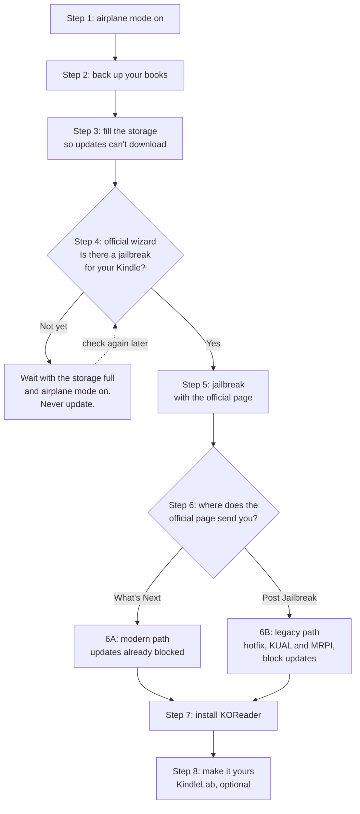

# Jailbreak your Kindle, one step at a time

**English** · [Português](jailbreak-guide.pt-BR.md)

Jailbreaking a Kindle usually means jumping between many pages, in the right order, full of new words.
This guide puts the whole trip on one page. Every step tells you **why** it matters, **what to do**, **how
you know it worked**, and links to the official [KindleModding](https://kindlemodding.org/) page with the
exact clicks and downloads.

> [!IMPORTANT]
> **The official pages come first.** KindleModding's volunteers update them whenever Amazon changes
> something. If an official page and this guide disagree, follow the official page and
> [let us know](https://github.com/gusthanks/kindlelab/issues/new/choose) so we can fix the guide.

**What we tested ourselves:** one Kindle Paperwhite 3 (7th generation) on firmware 5.16.2.1.1, jailbroken
with WinterBreak and finished through the older "legacy" path ([step 6B](#6b-legacy-path-post-jailbreak)).
The rest of this page summarizes the official guides. Other models: [compatibility](compatibility.md).

> [!TIP]
> **Not sure where you are?** Plug in the Kindle and open the
> [Where am I? page](https://gusthanks.github.io/kindlelab/). It looks at a few file names, right in your
> browser, and tells you your step. Nothing leaves your computer.

## The trip at a glance

| Step | What happens | Official page |
|---|---|---|
| [1](#step-1-turn-on-airplane-mode) | Airplane mode on: no surprise updates | — |
| [2](#step-2-back-up-your-books) | Copy your books to the computer | — |
| [3](#step-3-block-updates-by-filling-the-storage) | Fill the storage so an update can't download | [Prevent automatic updates](https://kindlemodding.org/jailbreaking/prevent-auto-update/) |
| [4](#step-4-find-the-right-jailbreak-for-your-kindle) | The official wizard picks your method | [Find my jailbreak](https://kindlemodding.org/jailbreak-wizard.html) |
| [5](#step-5-jailbreak) | Run the method | The page the wizard gives you |
| [6](#step-6-finish-the-jailbreak) | Keep updates out for good | [What's Next](https://kindlemodding.org/jailbreaking/whats-next/) or [Post Jailbreak](https://kindlemodding.org/jailbreaking/Legacy/post-jailbreak/) |
| [7](#step-7-install-koreader) | Install the reading app | [Getting KOReader](https://kindlemodding.org/jailbreaking/whats-next/getting-koreader/) |
| [8](#step-8-make-it-yours-optional) | One library, tidy list and more | [KindleLab](../README.md#what-kindlelab-adds) |

Set aside about two hours the first time. Most of it is copying files and waiting.

## Before you start

- **You need:** the Kindle, a USB cable that carries data (some cables only charge), a computer (Windows,
  macOS or Linux) and Wi-Fi.
- **Charge the Kindle** to at least half.
- **Read the official [jailbreaking overview](https://kindlemodding.org/jailbreaking/) once.** It explains
  what a jailbreak can and cannot do, and the official wizard reminds you if you skipped it.
- **What a jailbreak is:** it lets the Kindle run apps Amazon doesn't offer, such as KOReader. Your Amazon
  account, the store, your purchases and Kindle Unlimited keep working. It does not make books free, and it
  [can be undone](https://kindlemodding.org/jailbreaking/faq/unjailbreaking.html).
- **Three rules:**
  1. Keep airplane mode on, except when an official step tells you to turn it off.
  2. Never update the firmware, factory-reset or deregister the Kindle "to fix something". Ask first
     (see [stop signs](#stop-signs)).
  3. One step at a time. Check **Done when** before you move on.

## Step 1: Turn on airplane mode

**Why:** a Kindle that is online can download an update by itself, and updates often close the gap that
jailbreaks use.

**Do:** open the quick settings at the top of the Kindle's screen and turn on **Airplane Mode**.

**Done when:** the airplane icon shows at the top of the screen.

**Watch out:** brand-new Kindle? Its first setup asks for Wi-Fi. If the screen lets you skip that, skip it
until step 3 is done.

## Step 2: Back up your books

**Why:** the next steps copy files to the Kindle and fill its storage. With a copy of everything first,
nothing you added yourself can be lost.

**Do:** connect the Kindle to the computer with the cable and copy everything you see on it to a new folder
on the computer.

**Done when:** the folder on your computer has the same folders as the Kindle, including `documents` (your
books, and your highlights in `My Clippings.txt`).

**Good to know:**
- Books bought from Amazon can be downloaded again from your account. Your own files can't.
- Newer Kindles (11th generation and later) connect as a media device (MTP) instead of a drive. Windows and
  most Linux file managers open them; on a Mac you need an app that supports MTP.

## Step 3: Block updates by filling the storage

**Why:** an update needs free space to download. With only 50–90 MB free, the Kindle has no room for one,
even if it goes online by accident. This is the official protection before and during the jailbreak, and
while you wait for one.

**Do:**
1. In the main folder of the Kindle (not inside other folders), delete any file named like `update….bin` or
   `update.bin.tmp.partial`. That is an update waiting to install. If there is none, there is nothing to do.
2. Follow the official page [Prevent automatic updates](https://kindlemodding.org/jailbreaking/prevent-auto-update/).
   It uses a small script from the [Kindle-Filler-Disk](https://github.com/iiroak/Kindle-Filler-Disk)
   project that creates dummy files: `Filler.ps1` on Windows, `Filler.sh` on macOS and Linux. Newer (MTP)
   Kindles can't run the script; the same page links ready-made filler files to copy by hand.

**Done when:** on the Kindle, **Settings → Device Options → Device Info** shows about 50–90 MB available,
not more.

**Watch out:** keep the filler files until updates are blocked for good in step 6. With the storage full, it
is fine to connect to Wi-Fi and register the Kindle to your Amazon account if your jailbreak needs that.

## Step 4: Find the right jailbreak for your Kindle

**Why:** there are many jailbreak methods, and each one works only on some models and firmware versions.
The official wizard picks the right one for you.

**Do:**
1. On the Kindle, open **Settings → Device Options → Device Info** (on newer models, Settings is in the **⋮**
   menu). Write down the **firmware version** (for example `5.16.2.1.1`) and the **first 8 characters of
   the serial number**.
2. On the computer, open the official [jailbreak wizard](https://kindlemodding.org/jailbreak-wizard.html)
   and answer its questions: the start of the serial number, the firmware version, whether the Kindle can
   be registered to an Amazon account, and whether it shows ads on the lock screen.

**Done when:** the wizard names a method and links to its page (for example WinterBreak). Write it down. If
it lists alternatives, keep them as plan B.

**If there is no jailbreak for your Kindle yet:** stop here and keep the protection on: storage full,
airplane mode on, no updates. Check the wizard again from time to time. New methods do appear, but nobody
can promise when.

**Watch out:** the full serial number identifies your Kindle. Never post it in public; the wizard only needs
the beginning.

## Step 5: Jailbreak

**Why:** this is the step that unlocks the Kindle.

**Do:** open the official page the wizard gave you. Read it once from top to bottom before you touch
anything, then follow it exactly. Tips that help with most methods:
- Extract (unzip) the download on the computer first, then copy the files to the Kindle. Don't extract
  straight onto the Kindle.
- On macOS and Linux, names that start with a dot are hidden, and it's easy to leave them behind when
  copying (WinterBreak needs its `.active_content_sandbox` folder). Show hidden files first: **Ctrl+H** in
  most Linux file managers, **Cmd+Shift+.** in the macOS Finder.
- Eject the Kindle on the computer before you unplug the cable.
- Turn airplane mode off only when the official page tells you to.

**Done when:** the official page tells you what success looks like. With WinterBreak, about half a minute
after you tap its icon, lines of text cover the screen and the Kindle's interface restarts.

**If nothing happens:** start the official page again from the beginning. Don't reset the Kindle. Still
stuck? See [getting help](#getting-help).

## Step 6: Finish the jailbreak

At the end, the official page sends you to one of two places. Follow the one it names.

### 6A: Modern path, "What's Next"

Official: [What's Next](https://kindlemodding.org/jailbreaking/whats-next/).

- Updates are already blocked for you, and a package manager (KPM) is installed.
- Delete the filler files and any `update….bin` file, as in step 3.
- Read [Installing homebrew](https://kindlemodding.org/jailbreaking/whats-next/installing-homebrew.html)
  once. In a few minutes it explains scriptlets and KPM, which you will use next.
- Firmware 5.16.3 or newer: install the jailbreak manager,
  [Jobman](https://kindlemodding.org/jailbreaking/whats-next/jailbreaking-manager/). It controls the update
  block and can turn on a recovery mode.

**Done when:** the storage has free space again and, on firmware 5.16.3 or newer, Jobman opens.

### 6B: Legacy path, "Post Jailbreak"

Official: [Post Jailbreak](https://kindlemodding.org/jailbreaking/Legacy/post-jailbreak/). This is the path
we followed; our notes are in [docs/02](02-kual-mrpi-ota.md).

**Keep airplane mode on during this whole part:** on this path, updates are not blocked yet.

1. **Hotfix** ([official](https://kindlemodding.org/jailbreaking/Legacy/post-jailbreak/setting-up-a-hotfix/)).
   WinterBreak, SpringBreak and Sanctuary install it for you; with other methods, install it. Then tap
   **Run Hotfix** in your library.
2. **KUAL and MRPI** ([official](https://kindlemodding.org/jailbreaking/Legacy/post-jailbreak/installing-kual-mrpi/)):
   the app launcher and the package installer. They need about 220 MB free, so delete part of the filler
   files first. That is safe while airplane mode is on.
   > **This is where our Kindle got stuck for a year.** The storage was still full, so the installer
   > skipped KUAL and only said so in a log file. If KUAL doesn't show up in your library, check the free
   > space first.
3. **Block updates** ([official](https://kindlemodding.org/jailbreaking/Legacy/post-jailbreak/disable-ota.html)):
   in KUAL, choose **Rename OTA binaries → Rename**. The Kindle restarts.
4. **Check the block**, then delete the rest of the filler files and turn Wi-Fi back on. To check, use the
   *Check OTA Status* scriptlet from [scriptlets.notmarek.com](https://scriptlets.notmarek.com/), or
   `scripts/kindle-status.sh` once you have SSH ([docs/03](03-usbnetwork-ssh.md)).

**Done when:** KUAL opens from your library and the check says updates are blocked.

## Step 7: Install KOReader

**Why:** KOReader is the reading app most people jailbreak for: EPUB, PDF and comics, with many fonts and
settings.

- **Modern path (KPM):** restart the Kindle and turn Wi-Fi on. In the search bar of the home screen, type
  `;kpm update` and press Enter, then `;kpm install koreader`. Official:
  [Getting KOReader](https://kindlemodding.org/jailbreaking/whats-next/getting-koreader/).
- **Legacy path (KUAL):** copy KOReader by hand. Our tested walkthrough, including which download fits
  which firmware: [docs/04](04-koreader.md).

**Done when:** a KOReader item appears in your library and opens.

**Good to know:** KOReader can't open books bought from Amazon. They are protected (DRM) and keep opening in
the Kindle's own reader. KindleLab's one-library add-on lists them in KOReader too, with their covers, and
opens them in the Kindle's reader with one tap ([step 8](#step-8-make-it-yours-optional)).

## Step 8: Make it yours (optional)

The rest of this repository starts here. Everything below was tested on our Paperwhite 3:

- **The KindleLab reading setup:** one library for all your books, a tidy list, the cover of your book on
  the sleep screen, new books that organize themselves, a one-tap KOReader icon.
  See [koreader-config](../koreader-config/README.md) and [docs/07](07-reading-quality.md).
- **Safe access from a Linux computer:** SSH over the cable or Wi-Fi, keys only
  ([docs/03](03-usbnetwork-ssh.md)).
- **A full system backup** for older Kindles like ours ([docs/05](05-full-backup.md)).
- The safety rules we followed for all of it: [docs/00](00-safety.md).

## Stop signs

Stop and [ask for help](#getting-help) if:

- **The Kindle starts installing an update.** Don't unplug it or turn it off; let it finish. Then run the
  wizard again with the new firmware number.
- **Someone suggests a factory reset, deregistering, or updating "to fix it".** On a jailbroken Kindle
  these can make things worse: deregistering erases the `documents` folder, and a reset with updates
  blocked needs an [extra fix](https://kindlemodding.org/jailbreaking/faq/recovering-from-a-reset.html).
- **The Kindle keeps restarting by itself.** See the official
  [recovery page](https://kindlemodding.org/jailbreaking/faq/kindle-recovery.html) and ask on Discord.
- **An official page and this guide disagree.** Follow the official page.

## Getting help

- **Official support:** the [KindleModding Discord](https://discord.kindlemodding.org/). Community:
  [r/kindlejailbreak](https://www.reddit.com/r/kindlejailbreak/).
- **Tell them** your Kindle model, firmware version, jailbreak method and the step you are on. A photo of
  the screen helps.
- **Never post** your full serial number, your e-mail or your Wi-Fi name.
- **Problems with KindleLab's own files** (step 8):
  [open an issue](https://github.com/gusthanks/kindlelab/issues/new/choose).

## Words you will meet

| Word | In plain words |
|---|---|
| **Jailbreak** | Unlocks the Kindle so it can run apps Amazon doesn't offer. Your account, store and books keep working. |
| **Firmware** | The Kindle's system software. Its version number (like `5.16.2.1.1`) decides which jailbreak works. |
| **OTA update** | An update the Kindle downloads by itself ("over the air"). It often closes the jailbreak. |
| **Airplane mode** | Turns Wi-Fi off: no internet, no surprise updates. |
| **Filler files** | Dummy files that take up space so an update has no room to download. |
| **Wizard** | The official page that tells you which jailbreak fits your Kindle. |
| **hdnext** | The set of tools that modern jailbreaks install, including the update block and KPM. |
| **KPM** | A package manager: it installs apps when you type commands like `;kpm install koreader` in the search bar. |
| **Scriptlet** | A small app that shows up as a book in your library; tap it to run it. |
| **Jobman** | The jailbreak manager for firmware 5.16.3 and newer: update block, recovery mode. |
| **Hotfix** | Keeps a legacy jailbreak working after updates. It shows up as a **Run Hotfix** book. |
| **KUAL** | The app launcher of the legacy path. |
| **MRPI** | The legacy path's installer for `.bin` packages, used from KUAL. |
| **KOReader** | A free, open-source reading app for EPUB, PDF, comics and more. |
| **DRM** | Copy protection on store-bought books. KindleLab never removes it. |
| **MTP** | How newer Kindles connect to a computer: as a media device instead of a drive. |
| **SSH** | A secure way to control the Kindle from a computer's terminal (optional). |
| **Brick** | A Kindle that no longer starts. Following the official steps and the stop signs keeps this risk low. |

## Credits

The jailbreaks, tools and official guides are the work of the [KindleModding](https://kindlemodding.org/)
and [KindleTweaks](https://github.com/KindleTweaks) communities. If this guide helped you, thank them: their
site has a donation link. The filler script comes from
[Kindle-Filler-Disk](https://github.com/iiroak/Kindle-Filler-Disk).
