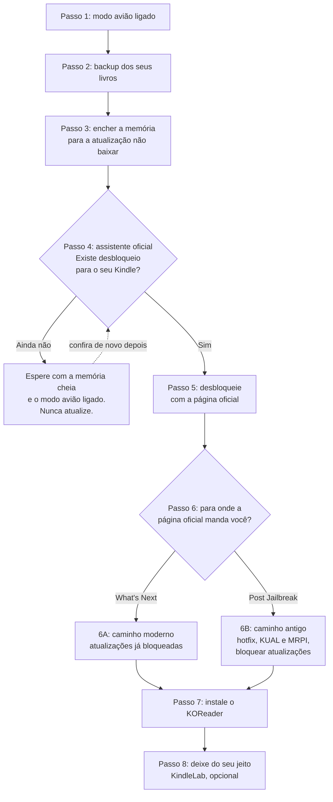

# Desbloqueie seu Kindle, um passo de cada vez

[English](jailbreak-guide.md) · **Português**

Desbloquear (fazer o *jailbreak* de) um Kindle costuma ser pular entre várias páginas, na ordem certa,
cheias de palavras novas. Este guia junta a viagem inteira numa página só. Cada passo diz **por que** ele
importa, **o que fazer**, **como saber que deu certo** e leva você à página oficial do
[KindleModding](https://kindlemodding.org/) com os cliques e os downloads exatos.

As páginas oficiais estão em inglês. A maioria dos navegadores traduz a página para você: clique com o botão
direito e escolha **Traduzir**.

> [!IMPORTANT]
> **As páginas oficiais vêm primeiro.** Os voluntários do KindleModding as atualizam sempre que a Amazon
> muda alguma coisa. Se uma página oficial e este guia disserem coisas diferentes, siga a página oficial e
> [avise a gente](https://github.com/gusthanks/kindlelab/issues/new/choose) para corrigirmos o guia.

**O que testamos nós mesmos:** um Kindle Paperwhite 3 (7ª geração) com firmware 5.16.2.1.1, desbloqueado com
o WinterBreak e finalizado pelo caminho antigo, chamado "legacy" ([passo 6B](#6b-caminho-antigo-post-jailbreak)).
O resto desta página resume os guias oficiais. Outros modelos: [compatibilidade](compatibility.md) (em
inglês).

## A viagem inteira

| Passo | O que acontece | Página oficial |
|---|---|---|
| [1](#passo-1-ative-o-modo-avião) | Modo avião ligado: nada de atualização surpresa | — |
| [2](#passo-2-faça-backup-dos-seus-livros) | Copie seus livros para o computador | — |
| [3](#passo-3-bloqueie-as-atualizações-enchendo-a-memória) | Encha a memória para a atualização não caber | [Prevent automatic updates](https://kindlemodding.org/jailbreaking/prevent-auto-update/) |
| [4](#passo-4-descubra-o-desbloqueio-certo-para-o-seu-kindle) | O assistente oficial escolhe o seu método | [Find my jailbreak](https://kindlemodding.org/jailbreak-wizard.html) |
| [5](#passo-5-desbloqueie) | Rode o método | A página que o assistente indicar |
| [6](#passo-6-termine-o-desbloqueio) | Bloqueie as atualizações de vez | [What's Next](https://kindlemodding.org/jailbreaking/whats-next/) ou [Post Jailbreak](https://kindlemodding.org/jailbreaking/Legacy/post-jailbreak/) |
| [7](#passo-7-instale-o-koreader) | Instale o aplicativo de leitura | [Getting KOReader](https://kindlemodding.org/jailbreaking/whats-next/getting-koreader/) |
| [8](#passo-8-deixe-do-seu-jeito-opcional) | Uma biblioteca só, lista limpa e mais | [KindleLab](../README.pt-BR.md#o-que-o-kindlelab-acrescenta) |

Reserve umas duas horas na primeira vez. A maior parte é copiar arquivos e esperar.

## Antes de começar

- **Você precisa de:** o Kindle, um cabo USB que passe dados (alguns só carregam), um computador (Windows,
  macOS ou Linux) e Wi-Fi.
- **Carregue o Kindle** até pelo menos a metade.
- **Leia uma vez a [apresentação oficial](https://kindlemodding.org/jailbreaking/).** Ela explica o que o
  desbloqueio faz e o que não faz, e o assistente oficial avisa se você pulou essa leitura.
- **O que é o desbloqueio:** ele deixa o Kindle rodar aplicativos que a Amazon não oferece, como o KOReader.
  Sua conta Amazon, a loja, seus livros comprados e o Kindle Unlimited continuam funcionando. Ele não deixa
  livros de graça, e [dá para desfazer](https://kindlemodding.org/jailbreaking/faq/unjailbreaking.html).
- **Três regras:**
  1. Mantenha o modo avião ligado, a não ser quando um passo oficial mandar desligar.
  2. Nunca atualize o firmware, restaure as configurações de fábrica nem cancele o registro do Kindle "para
     consertar alguma coisa". Pergunte antes (veja os [sinais de parada](#sinais-de-parada)).
  3. Um passo de cada vez. Confira o **Pronto quando** antes de seguir.

## Passo 1: Ative o modo avião

**Por quê:** um Kindle conectado pode baixar uma atualização sozinho, e as atualizações costumam fechar a
brecha que os desbloqueios usam.

**Faça:** abra as configurações rápidas no topo da tela do Kindle e ligue o **Modo avião** (*Airplane
Mode*).

**Pronto quando:** o ícone de avião aparece no topo da tela.

**Cuidado:** Kindle novinho? A primeira configuração pede Wi-Fi. Se a tela deixar pular essa parte, pule até
terminar o passo 3.

## Passo 2: Faça backup dos seus livros

**Por quê:** os próximos passos copiam arquivos para o Kindle e enchem a memória dele. Com uma cópia de tudo
antes, nada do que você colocou nele se perde.

**Faça:** ligue o Kindle no computador com o cabo e copie tudo o que aparecer nele para uma pasta nova no
computador.

**Pronto quando:** a pasta no computador tem as mesmas pastas do Kindle, inclusive `documents` (seus livros
e seus destaques, no arquivo `My Clippings.txt`).

**Bom saber:**
- Os livros comprados na Amazon podem ser baixados de novo pela sua conta. Os seus arquivos, não.
- Kindles mais novos (11ª geração em diante) aparecem como aparelho de mídia (MTP), e não como pen drive. O
  Windows e a maioria dos gerenciadores de arquivos do Linux abrem normalmente; no Mac é preciso um aplicativo
  que suporte MTP.

## Passo 3: Bloqueie as atualizações enchendo a memória

**Por quê:** uma atualização precisa de espaço livre para baixar. Com só 50–90 MB livres, não cabe nenhuma,
mesmo que o Kindle se conecte sem querer. Essa é a proteção oficial antes e durante o desbloqueio, e também
enquanto você espera um método sair.

**Faça:**
1. Na pasta principal do Kindle (fora das outras pastas), apague qualquer arquivo com nome parecido com
   `update….bin` ou `update.bin.tmp.partial`. É uma atualização esperando para ser instalada. Se não houver
   nenhum, não há nada a fazer.
2. Siga a página oficial [Prevent automatic updates](https://kindlemodding.org/jailbreaking/prevent-auto-update/).
   Ela usa um pequeno programa do projeto [Kindle-Filler-Disk](https://github.com/iiroak/Kindle-Filler-Disk)
   que cria arquivos de enchimento: `Filler.ps1` no Windows, `Filler.sh` no macOS e no Linux. Kindles mais
   novos (MTP) não rodam esse programa; a mesma página tem arquivos de enchimento prontos para copiar à mão.

**Pronto quando:** no Kindle, **Configurações → Opções do dispositivo → Informações do dispositivo** (em
inglês: *Settings → Device Options → Device Info*) mostra uns 50–90 MB disponíveis, não mais que isso.

**Cuidado:** guarde os arquivos de enchimento até as atualizações ficarem bloqueadas de vez, no passo 6. Com
a memória cheia, pode conectar no Wi-Fi e registrar o Kindle na sua conta Amazon se o seu método pedir isso.

## Passo 4: Descubra o desbloqueio certo para o seu Kindle

**Por quê:** existem muitos métodos de desbloqueio, e cada um só funciona em alguns modelos e versões de
firmware. O assistente oficial escolhe o certo para você.

**Faça:**
1. No Kindle, abra **Configurações → Opções do dispositivo → Informações do dispositivo** (nos modelos mais
   novos, as Configurações ficam no menu **⋮**). Anote a **versão do firmware** (por exemplo `5.16.2.1.1`)
   e os **8 primeiros caracteres do número de série**.
2. No computador, abra o [assistente oficial](https://kindlemodding.org/jailbreak-wizard.html) e responda às
   perguntas: o começo do número de série, a versão do firmware, se o Kindle pode ser registrado numa conta
   Amazon e se ele mostra anúncios na tela de bloqueio.

**Pronto quando:** o assistente diz o nome de um método e dá o link da página dele (por exemplo,
WinterBreak). Anote. Se ele mostrar alternativas, guarde como plano B.

**Se ainda não existir desbloqueio para o seu Kindle:** pare aqui e mantenha a proteção: memória cheia, modo
avião ligado e nenhuma atualização. Volte ao assistente de vez em quando. Novos métodos aparecem, mas
ninguém consegue prometer quando.

**Cuidado:** o número de série completo identifica o seu Kindle. Nunca publique; o assistente só precisa do
começo.

## Passo 5: Desbloqueie

**Por quê:** este é o passo que destrava o Kindle.

**Faça:** abra a página oficial que o assistente indicou. Leia uma vez inteira, do começo ao fim, antes de
mexer em qualquer coisa, e depois siga exatamente. Dicas que ajudam na maioria dos métodos:
- Descompacte o download no computador primeiro e depois copie os arquivos para o Kindle. Não descompacte
  direto no Kindle.
- No macOS e no Linux, nomes que começam com ponto ficam escondidos, e é fácil esquecê-los na cópia (o
  WinterBreak precisa da pasta `.active_content_sandbox`). Mostre os arquivos ocultos antes: **Ctrl+H** na
  maioria dos gerenciadores de arquivos do Linux, **Cmd+Shift+.** no Finder do macOS.
- Ejete o Kindle no computador antes de tirar o cabo.
- Desligue o modo avião só quando a página oficial mandar.

**Pronto quando:** a página oficial diz como é o sucesso. No WinterBreak, uns 30 segundos depois de tocar no
ícone dele, linhas de texto cobrem a tela e a interface do Kindle reinicia.

**Se nada acontecer:** comece a página oficial de novo, do início. Não restaure o Kindle. Continua travado?
Veja [onde pedir ajuda](#onde-pedir-ajuda).

## Passo 6: Termine o desbloqueio

No final, a página oficial manda você para um de dois lugares. Siga o que ela indicar.

### 6A: Caminho moderno, "What's Next"

Oficial: [What's Next](https://kindlemodding.org/jailbreaking/whats-next/).

- As atualizações já ficam bloqueadas para você, e um gerenciador de pacotes (KPM) vem instalado.
- Apague os arquivos de enchimento e qualquer arquivo `update….bin`, como no passo 3.
- Leia uma vez [Installing homebrew](https://kindlemodding.org/jailbreaking/whats-next/installing-homebrew.html).
  Em poucos minutos ela explica os scriptlets e o KPM, que você vai usar em seguida.
- Firmware 5.16.3 ou mais novo: instale o gerenciador do desbloqueio,
  [Jobman](https://kindlemodding.org/jailbreaking/whats-next/jailbreaking-manager/). Ele controla o bloqueio
  de atualizações e pode ligar um modo de recuperação.

**Pronto quando:** a memória tem espaço livre de novo e, no firmware 5.16.3 ou mais novo, o Jobman abre.

### 6B: Caminho antigo, "Post Jailbreak"

Oficial: [Post Jailbreak](https://kindlemodding.org/jailbreaking/Legacy/post-jailbreak/). Foi o caminho que
seguimos; nossas anotações estão no [docs/02](02-kual-mrpi-ota.md) (em inglês).

**Mantenha o modo avião ligado durante toda esta parte:** neste caminho, as atualizações ainda não estão
bloqueadas.

1. **Hotfix** ([oficial](https://kindlemodding.org/jailbreaking/Legacy/post-jailbreak/setting-up-a-hotfix/)).
   O WinterBreak, o SpringBreak e o Sanctuary já instalam o hotfix; com outros métodos, instale. Depois toque
   em **Run Hotfix** na sua biblioteca.
2. **KUAL e MRPI** ([oficial](https://kindlemodding.org/jailbreaking/Legacy/post-jailbreak/installing-kual-mrpi/)):
   o lançador de aplicativos e o instalador de pacotes. Eles precisam de uns 220 MB livres, então apague
   antes uma parte dos arquivos de enchimento. Com o modo avião ligado, isso é seguro.
   > **Foi aqui que o nosso Kindle ficou travado por um ano.** A memória ainda estava cheia, então o
   > instalador pulou o KUAL e só avisou num arquivo de registro. Se o KUAL não aparecer na sua biblioteca,
   > confira primeiro o espaço livre.
3. **Bloqueie as atualizações** ([oficial](https://kindlemodding.org/jailbreaking/Legacy/post-jailbreak/disable-ota.html)):
   no KUAL, escolha **Rename OTA binaries → Rename**. O Kindle reinicia.
4. **Confira o bloqueio**, depois apague o resto dos arquivos de enchimento e ligue o Wi-Fi de novo. Para
   conferir, use o scriptlet *Check OTA Status* de [scriptlets.notmarek.com](https://scriptlets.notmarek.com/),
   ou o `scripts/kindle-status.sh` quando tiver SSH ([docs/03](03-usbnetwork-ssh.md), em inglês).

**Pronto quando:** o KUAL abre pela sua biblioteca e a conferência diz que as atualizações estão bloqueadas.

## Passo 7: Instale o KOReader

**Por quê:** o KOReader é o aplicativo de leitura que leva a maioria das pessoas a desbloquear: EPUB, PDF e
quadrinhos, com muitas fontes e ajustes.

- **Caminho moderno (KPM):** reinicie o Kindle e ligue o Wi-Fi. Na barra de busca da tela inicial, digite
  `;kpm update` e aperte Enter, depois `;kpm install koreader`. Oficial:
  [Getting KOReader](https://kindlemodding.org/jailbreaking/whats-next/getting-koreader/).
- **Caminho antigo (KUAL):** copie o KOReader à mão. Nosso passo a passo testado, incluindo qual download
  serve para qual firmware: [docs/04](04-koreader.md) (em inglês).

**Pronto quando:** um item do KOReader aparece na sua biblioteca e abre.

**Bom saber:** o KOReader não abre livros comprados na Amazon. Eles são protegidos (DRM) e continuam abrindo
no leitor do próprio Kindle. O complemento de biblioteca única do KindleLab mostra esses livros no KOReader
também, com capa, e abre cada um no leitor do Kindle com um toque ([passo 8](#passo-8-deixe-do-seu-jeito-opcional)).

## Passo 8: Deixe do seu jeito (opcional)

O resto deste repositório começa aqui. Tudo abaixo foi testado no nosso Paperwhite 3 (guias em inglês):

- **A configuração de leitura do KindleLab:** uma biblioteca só para todos os seus livros, lista limpa, a
  capa do livro na tela de descanso, livros novos que se organizam sozinhos e um ícone de um toque para o
  KOReader. Veja o [koreader-config](../koreader-config/README.md) e o [docs/07](07-reading-quality.md).
- **Acesso seguro por um computador com Linux:** SSH pelo cabo ou pelo Wi-Fi, só com chave
  ([docs/03](03-usbnetwork-ssh.md)).
- **Backup completo do sistema** para Kindles mais antigos como o nosso ([docs/05](05-full-backup.md)).
- As regras de segurança que seguimos em tudo isso: [docs/00](00-safety.md).

## Sinais de parada

Pare e [peça ajuda](#onde-pedir-ajuda) se:

- **O Kindle começar a instalar uma atualização.** Não tire da tomada nem desligue; deixe terminar. Depois
  rode o assistente de novo com o número do firmware novo.
- **Alguém sugerir restaurar as configurações de fábrica, cancelar o registro ou atualizar "para
  consertar".** Num Kindle desbloqueado isso pode piorar as coisas: cancelar o registro apaga a pasta
  `documents`, e restaurar com as atualizações bloqueadas exige um
  [conserto extra](https://kindlemodding.org/jailbreaking/faq/recovering-from-a-reset.html).
- **O Kindle ficar reiniciando sozinho.** Veja a [página oficial de recuperação](https://kindlemodding.org/jailbreaking/faq/kindle-recovery.html)
  e pergunte no Discord.
- **Uma página oficial e este guia disserem coisas diferentes.** Siga a página oficial.

## Onde pedir ajuda

- **Suporte oficial:** o [Discord do KindleModding](https://discord.kindlemodding.org/) (em inglês).
  Comunidade: [r/kindlejailbreak](https://www.reddit.com/r/kindlejailbreak/).
- **Conte** o modelo do Kindle, a versão do firmware, o método de desbloqueio e o passo em que você está.
  Uma foto da tela ajuda.
- **Nunca publique** o número de série completo, seu e-mail ou o nome da sua rede Wi-Fi.
- **Problemas com os arquivos do próprio KindleLab** (passo 8):
  [abra um chamado](https://github.com/gusthanks/kindlelab/issues/new/choose).

## Palavras que você vai encontrar

| Palavra | Em palavras simples |
|---|---|
| **Jailbreak (desbloqueio)** | Destrava o Kindle para ele rodar aplicativos que a Amazon não oferece. Sua conta, a loja e os livros continuam funcionando. |
| **Firmware** | O sistema do Kindle. O número da versão (como `5.16.2.1.1`) decide qual desbloqueio funciona. |
| **Atualização OTA** | Uma atualização que o Kindle baixa sozinho ("pelo ar"). Ela costuma fechar o desbloqueio. |
| **Modo avião** | Desliga o Wi-Fi: sem internet, sem atualização surpresa. |
| **Arquivos de enchimento** | Arquivos sem conteúdo útil que ocupam espaço para a atualização não caber. |
| **Assistente** (*wizard*) | A página oficial que diz qual desbloqueio serve para o seu Kindle. |
| **hdnext** | O conjunto de ferramentas que os desbloqueios modernos instalam, incluindo o bloqueio de atualizações e o KPM. |
| **KPM** | Um gerenciador de pacotes: instala aplicativos quando você digita comandos como `;kpm install koreader` na barra de busca. |
| **Scriptlet** | Um pequeno aplicativo que aparece como livro na sua biblioteca; toque para rodar. |
| **Jobman** | O gerenciador do desbloqueio para firmware 5.16.3 ou mais novo: bloqueio de atualizações, modo de recuperação. |
| **Hotfix** | Mantém um desbloqueio antigo funcionando depois de atualizações. Aparece como o livro **Run Hotfix**. |
| **KUAL** | O lançador de aplicativos do caminho antigo. |
| **MRPI** | O instalador de pacotes `.bin` do caminho antigo, usado pelo KUAL. |
| **KOReader** | Um aplicativo de leitura gratuito e de código aberto para EPUB, PDF, quadrinhos e mais. |
| **DRM** | A proteção contra cópia dos livros comprados. O KindleLab nunca remove. |
| **MTP** | O jeito como os Kindles mais novos se ligam ao computador: como aparelho de mídia, e não como pen drive. |
| **SSH** | Um jeito seguro de comandar o Kindle pelo terminal de um computador (opcional). |
| **Brick ("tijolo")** | Um Kindle que não liga mais. Seguir os passos oficiais e os sinais de parada mantém esse risco baixo. |

## Créditos

Os desbloqueios, as ferramentas e os guias oficiais são trabalho das comunidades
[KindleModding](https://kindlemodding.org/) e [KindleTweaks](https://github.com/KindleTweaks). Se este guia
ajudou você, agradeça a elas: o site oficial tem um link para doações. O programa de enchimento vem do
[Kindle-Filler-Disk](https://github.com/iiroak/Kindle-Filler-Disk).
